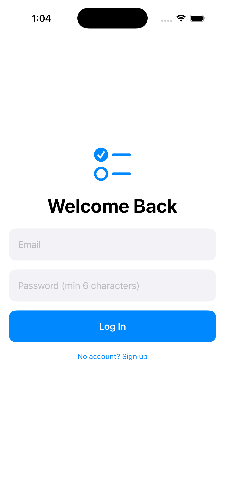
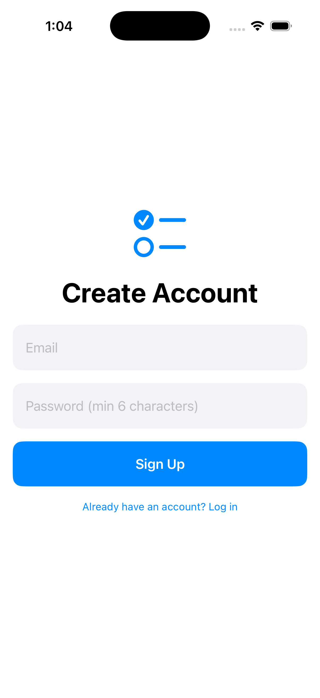
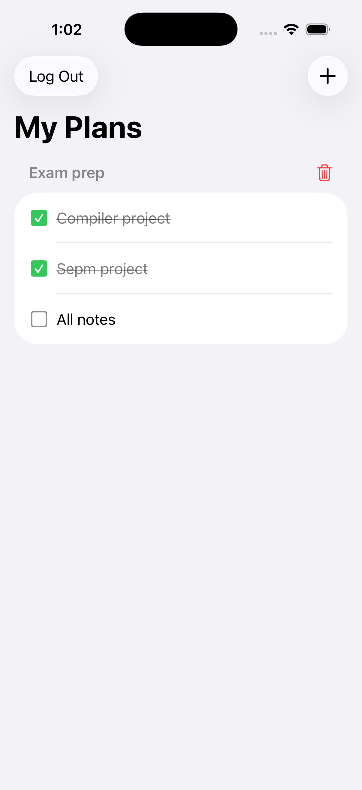
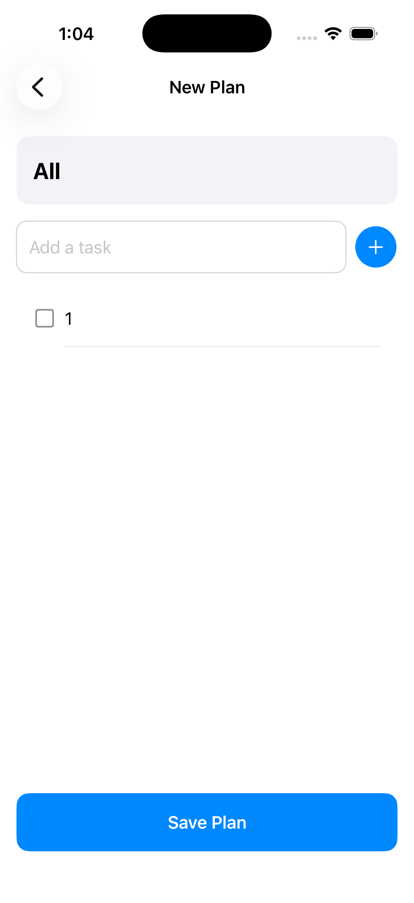
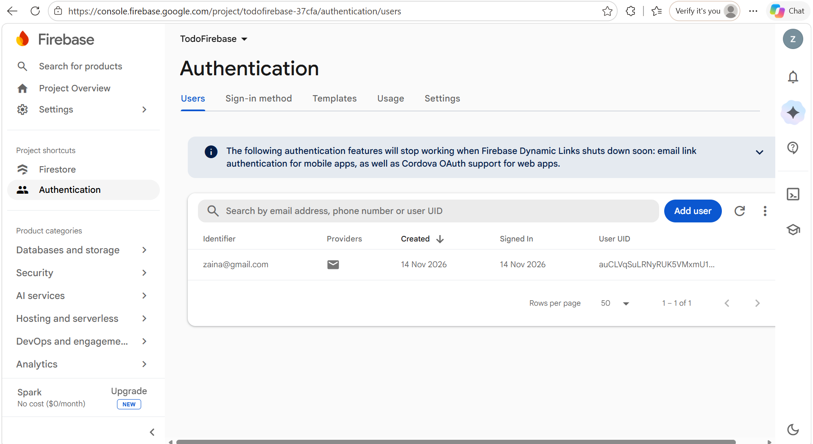
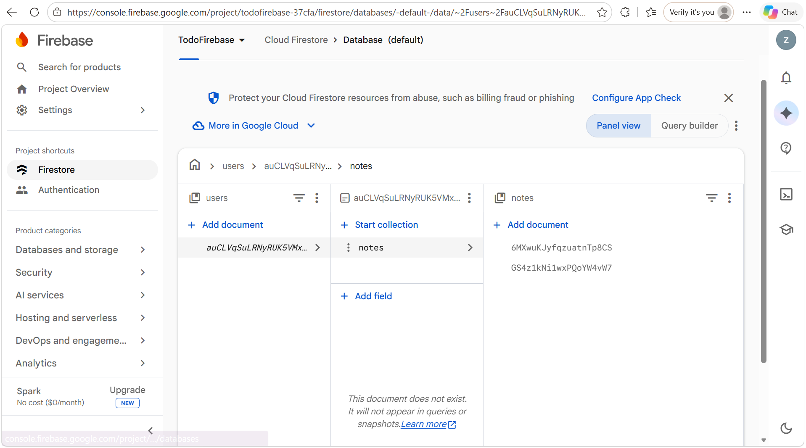

# TodoFirebase – SwiftUI To-Do List with Firebase

A simple iOS to-do list app built with **SwiftUI** and **Firebase**.
Users sign up / log in with email and password, create plans with a heading and a list of tasks,
and tick tasks off with checkboxes. Every saved plan is shown under its own heading and is synced
to **Cloud Firestore** in real time.

## Features

- Email & password sign up / log in / log out (Firebase Authentication)
- Create a plan: heading + any number of tasks
- Each saved plan appears as a separate heading on the home screen
- Checkbox to mark tasks done / not done (saved instantly to Firestore)
- Delete a whole plan
- Each user only sees their own plans

## Screenshots

| Login | Sign Up | My Plans | New Plan |
|:---:|:---:|:---:|:---:|
|  |  |  |  |

| Firebase Authentication | Firestore Data |
|:---:|:---:|
|  |  |

## Tech Stack

- Swift, SwiftUI
- MVVM architecture (`AuthViewModel`, `NoteViewModel`)
- Firebase Authentication
- Cloud Firestore
- Swift Package Manager

## SwiftUI Concepts Used

| Concept | Where |
|---|---|
| `@State` | Text fields, task list, navigation path |
| `@Binding` | `AddNoteView` receives `path` to go back after saving; task checkboxes |
| `@StateObject` / `@ObservedObject` / `@EnvironmentObject` | View models |
| Shapes | `RoundedRectangle` and `Circle` backgrounds for fields and buttons |
| `Spacer` | Layout in login screen and checkbox rows |
| `NavigationStack` + `NavigationPath` | Navigation from My Plans to New Plan |
| `NavigationLink(value:)` + `.navigationDestination` | The **+** button |

## Project Structure

```
TodoFirebase/
├── TodoFirebase.xcodeproj
└── TodoFirebase/
    ├── TodoFirebaseApp.swift   // App entry, FirebaseApp.configure()
    ├── Models.swift            // TaskItem, Note
    ├── AuthViewModel.swift     // Sign up, log in, log out
    ├── NoteViewModel.swift     // Firestore create / read / update / delete
    ├── ContentView.swift       // Login or NoteView depending on auth state
    ├── LoginView.swift         // Login & sign-up screen
    ├── NoteView.swift          // All plans under headings + CheckboxRow
    └── AddNoteView.swift       // Create a new plan
```

## Firestore Data Structure

```
users (collection)
└── {userId} (document)
    └── notes (collection)
        └── {noteId} (document)
            ├── title: "Exam Prep"
            ├── createdAt: timestamp
            └── tasks: [ { id, text: "Revise chapter 3", isDone: false }, ... ]
```

## How to Run

Requirements: a Mac with Xcode 26 (iOS 26.5 simulator or newer), and a Firebase project.

1. **Firebase Console**
   - Create a project and add an iOS app with bundle ID `com.zaina.TodoFirebase`
     (or change the bundle ID in Xcode to match yours).
   - Download `GoogleService-Info.plist`.
   - Authentication → Sign-in method → enable **Email/Password**.
   - Firestore Database → Create database.
2. **Xcode**
   - Open `TodoFirebase/TodoFirebase.xcodeproj`.
   - Drag `GoogleService-Info.plist` into the `TodoFirebase/TodoFirebase` folder (tick *Copy items if needed* and the app target).
     This file is not included in the repo.
   - Packages are resolved automatically (`firebase-ios-sdk`: FirebaseAuth, FirebaseFirestore).
   - Select an iPhone simulator and press **Run** (⌘R).

## Firestore Security Rules

```
rules_version = '2';
service cloud.firestore {
  match /databases/{database}/documents {
    match /users/{uid}/notes/{noteId} {
      allow read, write: if request.auth != null && request.auth.uid == uid;
    }
  }
}
```

## Author

Zaina
